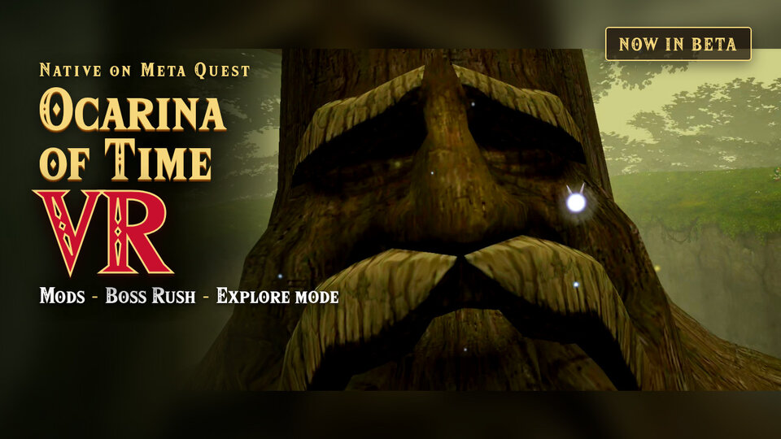
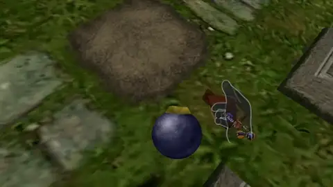
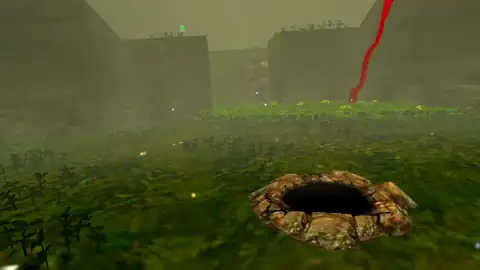
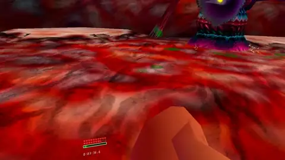
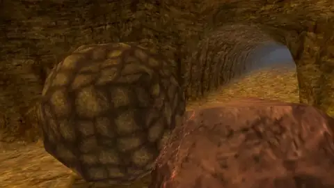
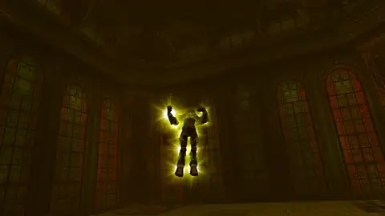
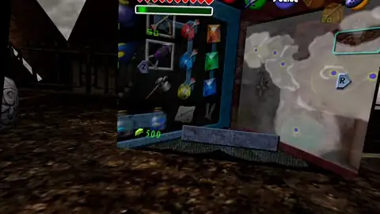
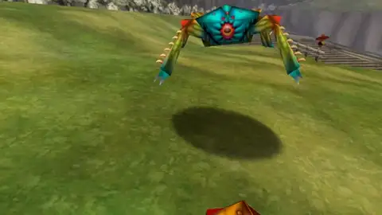
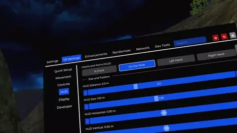

# oot-vr

_The Legend of Zelda: Ocarina of Time_ in first person on the Meta Quest 3S.
The game runs on the headset. You do not need a PC to play.

**Status: beta.** We tested many areas of the game, from Kokiri Forest to the
fight with Ganon. We did not play the full story from the start to the end.
Some problems are known: read [`STATUS.md`](STATUS.md) and the
[open issues](https://github.com/gibranfelix/oot-vr/issues) before you play.

[](https://youtu.be/kHN2fxl0lSU)

All clips are recordings from a Meta Quest 3S. Some clips use texture mods.
The game does not contain mods.

|                                                                                              |                                                                                              |
| -------------------------------------------------------------------------------------------- | -------------------------------------------------------------------------------------------- |
|                        |       |
| Throw bombs with your arm.                                                                   | Put a bombchu on the floor.                                                                  |
|                                         |                           |
| The arrow goes along the bow.                                                                | Throw the boomerang with your arm.                                                           |
|                         |             |
| Swing the Megaton Hammer.                                                                    | The Mirror Shield reflects the beam of Twinrova.                                             |
|      |           |
| Boss Rush: Ganondorf.                                                                        | EXPLORE: all the items from the start.                                                       |
|              |              |
| Hold the shield in front of you to block.                                                    | Quick Setup in VR Settings.                                                                  |
|              |                                                                                              |
| Charge the sword, then swing to do the spin attack.                                          |                                                                                              |

> [!IMPORTANT]
> You must own a legal copy of _The Legend of Zelda: Ocarina of Time_. Make a
> dump of your own cartridge or disc.
>
> This repository and its releases do not contain game assets. We do not supply
> ROMs. Do not ask for ROMs or share ROMs in the issues.

## Contents

- [Features](#features)
- [Install](#install)
- [Update](#update)
- [Mods](#mods)
- [Controls](#controls)
- [Build from source](#build-from-source)
- [Documentation](#documentation)
- [Credits](#credits)
- [License](#license)

## Features

**VR**

- Stereo 3D. The refresh rate changes automatically between 90 Hz and 72 Hz.
- First-person camera at the eye height of Link. The camera follows your head.
  A third-person view is also available.
- Automatic world scale for child Link and adult Link.

**Physical weapons.** All weapons use your hands and your arms:

| Weapon | How |
| --- | --- |
| Sword, Deku stick, Megaton Hammer | Swing your hand. |
| Spin attack | Put the sword hand at the side of your hip, with the tip of the blade to the back. When the controller vibrates, swing fast. |
| Shield | Hold it in front of you to block. The Mirror Shield reflects the Twinrova beams. |
| Bow, slingshot, hookshot | Aim with your hand. The shot goes along the weapon. |
| Boomerang | Throw it with your arm. |
| Bombs, Deku nuts, bombchus | Take them from your belt, and throw them with your arm. |

**Menus and controls**

- Item selector: take an item with your hand.
- HUD on the wrist. Menus and the pause screen show on a panel that floats in
  front of you.
- SoH menu with the Touch controllers and a laser pointer.
- Quick Setup: view, sword hand, turn style, item selector or C buttons, and
  HUD position.

**Game**

- Setup on the headset: select your dump, and the headset makes the game files.
  Ocarina of Time and Master Quest are supported.
- Install mods on the headset with **Add Mods**: textures, models, and
  translations.
- EXPLORE: a new file starts as adult Link in the Temple of Time, with all the
  items, songs, and medallions.
- Boss Rush.
- ARENA: adult Link fights waves of enemies. Each wave is larger and stronger.
  The game shows the wave and the time when Link dies.
- Update on the headset: the game finds a new release and installs it.

## Install

You need:

- a cartridge or disc of Ocarina of Time that you own;
- a PC with Windows, macOS, or Linux;
- a USB-C cable for the headset.

Do these steps one time.

### 1. Make a dump of your game

Use one of these versions:

| Platform    | Region                 | Versions                                           |
| ----------- | ---------------------- | -------------------------------------------------- |
| Nintendo 64 | Europe (PAL)           | 1.0, 1.1                                           |
| Nintendo 64 | North America (NTSC-U) | 1.0, 1.1, 1.2                                      |
| Nintendo 64 | Japan (NTSC-J)         | 1.0, 1.1, 1.2                                      |
| GameCube    | Europe (PAL)           | Ocarina of Time, Master Quest                      |
| GameCube    | North America (NTSC-U) | Ocarina of Time, Master Quest                      |
| GameCube    | Japan (NTSC-J)         | Ocarina of Time, Master Quest, Collector's Edition |

Compare the SHA-1 of your dump with
[`port/docs/supportedHashes.json`](port/docs/supportedHashes.json). We tested
only the European GameCube version.

### 2. Enable developer mode on the headset

Follow the steps from Meta:
[Device Setup](https://developers.meta.com/horizon/documentation/native/android/mobile-device-setup/).

### 3. Install the game with SideQuest

1. Install [SideQuest](https://sidequestvr.com/setup-howto) on your PC.
2. Connect the headset to the PC with the USB-C cable.
3. In the headset, select **Always allow from this computer**, then **Allow**.
4. Download `oot-vr-<version>.apk` from
   [Releases](https://github.com/gibranfelix/oot-vr/releases).
5. Drag the APK into the SideQuest window.
6. With the SideQuest file manager, copy your dump into the `Download` folder
   of the headset.

With `adb`:

```
adb install -r oot-vr-<version>.apk
adb push <your-dump>.z64 /sdcard/Download/
```

### 4. Start the game

1. In the headset, open **Library** > **Unknown Sources** > **OoT VR**.
2. Select **Select ROM**, then select your dump in the `Download` folder.
3. Wait some minutes for the extraction. Do not remove the headset.
4. Optional: select **Allow** to use mods. Read [Mods](#mods).

The game makes `oot.o2r` from your dump. Then you can delete the dump. The next
starts go directly to the game.

If the game does not start, read "If the game does not start" in
[`port/Android/README.md`](port/Android/README.md).

## Update

The game looks for a new release at each start. The headset must have an
internet connection.

1. When a new release is available, the menu opens on the file select screen.
   You can also select **VR Settings** > **Update** at any time.
2. Select **Update**. Wait for the download.
3. The first time, the headset asks for a permission. Select **Settings**, turn
   on **Allow from this source**, and go back.
4. On the panel of the installer, confirm the install. The game closes.
5. Open **OoT VR** again. Your saves stay.

If your version does not have **VR Settings** > **Update**, install the new
release with SideQuest one time. Do the steps in
[3. Install the game with SideQuest](#3-install-the-game-with-sidequest).

## Mods

The game loads Ship of Harkinian mods: `.o2r`, `.otr`, `.zip`, and `.7z`.

> [!IMPORTANT]
> The mods are not part of oot-vr. Their authors give them. This project does
> not keep copies.

To install a mod, the game needs access to the `oot-vr/` folder. Select **VR
Settings** > **Mods** > **Allow Access**, and turn on the permission for OoT VR.

To change the load order, open the SoH menu and select **Settings** > **Mod
Menu**. When two mods change the same texture, the higher mod shows.

### Automatic install

The headset must have an internet connection.

1. Select **VR Settings** > **Mods**.
2. Select **Download** below a mod, and then select **Download** again.
3. Restart the game.

### Manual install

1. Download the mod from the page of its author.
2. Copy the file into the `Download` folder of the headset with SideQuest.
3. Select **VR Settings** > **Mods** > **Add Mods**, and select the file.
4. Restart the game.

### Request a mod

Open a
[mod request](https://github.com/gibranfelix/oot-vr/issues/new?template=add_mod.yml).

### Remove a mod from the Mod list

Open a
[removal request](https://github.com/gibranfelix/oot-vr/issues/new?template=remove_mod.yml).
You do not need to give a reason.

## Controls

The right hand holds the sword, the boomerang, and the items that you swing.
Either hand takes a bomb, a bombchu, or a Deku nut from the belt. The left hand
holds the shield, the bow, the slingshot, the hookshot, and the ocarina.

| Control                       | Action                                                                  |
| ----------------------------- | ----------------------------------------------------------------------- |
| Left thumbstick               | Move Link.                                                              |
| Right thumbstick ← → ↓        | Put the C-Left, C-Right, or C-Down item in your hand.                   |
| Right thumbstick ↑            | Talk to Navi.                                                           |
| Right thumbstick click (hold) | Open the item selector. Move your hand to an item, then release.        |
| Left trigger                  | Use the item. For the bow, hold to pull the string, release to shoot.   |
| Right trigger                 | Z-target.                                                               |
| Right grip                    | Boomerang: hold, move the arm to throw, then release.                   |
| Both grips (hold)             | Hold the sword and the shield.                                          |
| A button                      | N64 A: action, talk, roll.                                              |
| B button                      | N64 B.                                                                  |
| Y button                      | Open or close the SoH menu.                                             |
| Left Menu button              | Start: open the pause screen.                                           |
| Left grip / right grip        | Previous page / next page of the pause screen.                          |

### Items

| Item                                                         | Use                                                        |
| ------------------------------------------------------------ | ---------------------------------------------------------- |
| Sword, Deku stick, Megaton Hammer                            | Swing your hand.                                           |
| Spin attack                                                  | Put the sword hand at the side of your hip, with the tip of the blade to the back. The charge starts, and the controller vibrates. Move the charged sword as you want, then swing fast. With magic, you do the magic spin. |
| Bow, slingshot, hookshot                                     | Point the weapon. The aim mark shows where the shot hits.  |
| Boomerang                                                    | Hold the right grip, throw with the arm, release the grip. |
| Bombs                                                        | Push a grip at the belt, throw with the arm, release the grip. A slow release drops the bomb. The left trigger also throws. |
| Deku nuts                                                    | The same as the bombs. The nut flashes when it touches a wall or the floor. |
| Bombchus                                                     | Push a grip at the belt, then release it. The bombchu runs where the controller points, or along a fast hand. The left trigger also puts it down. |
| Empty bottle                                                 | Left trigger.                                              |
| Ocarina, spells, masks, full bottles, other items            | The item selector uses the item immediately.               |

### Quick Setup

By default, you turn with your body and the HUD is on the wrist. To change it,
go to VR Settings > **Quick Setup**:

| Setting                | Choices                                       |
| ---------------------- | --------------------------------------------- |
| View                   | First Person, Third Person                    |
| Sword Hand             | Right, Left                                   |
| Right Stick            | Items, Snap Turn, Smooth Turn                 |
| Use Items              | Item Selector, C Buttons                      |
| Hearts and Items (HUD) | In Front, On the Wrist, Left Hand, Right Hand |

The right thumbstick takes items or turns. It does not do the two:

| Right Stick | Use Items     | Take an item                                                            |
| ----------- | ------------- | ----------------------------------------------------------------------- |
| Items       | Item Selector | Flick the right thumbstick, or hold its click and move your hand.       |
| Turn        | Item Selector | Hold the right thumbstick click and move your hand.                     |
| Items       | C Buttons     | Flick the right thumbstick, or push X, B, or the left Menu button.      |
| Turn        | C Buttons     | Push X (C-Left), B (C-Down), or the left Menu button (C-Right).         |

With C Buttons, the right trigger is N64 B, and the left thumbstick click is
Start. The belt works only with the item selector. To change a button, go to VR
Settings > **Controls**.

### SoH menu

The SoH menu contains VR Settings and the settings of Ship of Harkinian. Push
the Y button to open or close it. While the menu is open, the controls operate
the menu, not Link.

| Control                         | Menu action                             |
| ------------------------------- | --------------------------------------- |
| Point a controller at the panel | Move the pointer.                       |
| Trigger of that hand            | Click.                                  |
| Right thumbstick ↑ ↓            | Scroll.                                 |
| Left thumbstick                 | Move the selection.                     |
| A button                        | Accept.                                 |
| B button                        | Go back.                                |
| Left grip / right grip          | Previous tab / next tab.                |

The game does not stop while the menu is open. With C Buttons, C-Right is on
the left Menu button.

### Ocarina

The ocarina uses the N64 layout:

| Note                          | Control                  |
| ----------------------------- | ------------------------ |
| A (D4)                        | A button                 |
| C-Up, C-Down, C-Left, C-Right | Right thumbstick ↑ ↓ ← → |
| Half step up / down           | Right grip / left grip   |
| Put the ocarina away          | B button                 |

## Build from source

Read [`port/Android/README.md`](port/Android/README.md). The script
`port/Android/build-apk.sh` builds the APK. The same document tells how to make
`oot.o2r` with the tools of this repository.

## Documentation

| File                                           | Contents                                             |
| ---------------------------------------------- | ---------------------------------------------------- |
| [`STATUS.md`](STATUS.md)                       | What works, and where to find the open work          |
| [`docs/architecture.md`](docs/architecture.md) | How the VR layer connects to the game and the engine |
| [`CONTEXT.md`](CONTEXT.md)                     | The terms that this project uses                     |
| [`CONTRIBUTING.md`](CONTRIBUTING.md)           | How to send changes                                  |
| [`AGENTS.md`](AGENTS.md)                       | Rules for contributors and for AI agents             |

## Credits

- **[ShinyWindow](https://github.com/ShinyWindow)**:
  [`Shipwright-VR`](https://github.com/ShinyWindow/Shipwright-VR) and
  [`libultraship-vr`](https://github.com/ShinyWindow/libultraship-vr). The VR
  layer comes from these projects: OpenXR, stereo render, first-person camera,
  physical combat, and many control fixes.
- **[Harbour Masters](https://github.com/HarbourMasters)**:
  [Ship of Harkinian](https://github.com/HarbourMasters/Shipwright) 9.2.3
  "Ackbar Delta", the base of this port.
- **[Kenix3](https://github.com/Kenix3)**:
  [`libultraship`](https://github.com/Kenix3/libultraship).
- **[linkzenic](https://github.com/linkzenic)**:
  [`Shipwright-Android`](https://github.com/linkzenic/Shipwright-Android), Ship
  of Harkinian on Android arm64 with GLES3.
- **[zeldaret](https://github.com/zeldaret/oot)**: the decompilation of Ocarina
  of Time.

## License

The code that this project wrote is MIT ([`LICENSE`](LICENSE)). Ship of
Harkinian, its VR layer, and the Android wrapper do not have a license.
[`NOTICE.md`](NOTICE.md) gives the license of each directory.

Zelda and Ocarina of Time are trademarks of Nintendo. This project has no
connection with Nintendo.
